# Dolores Rally
---

## Ronda 1 

  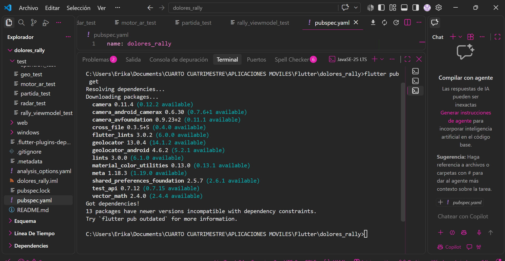

---

## Ronda 2 

*(con una función nueva)*

<table>
  <tr>
    <th align="center"></th>
    <th align="center"></th>
  </tr>
  <tr>
    <td>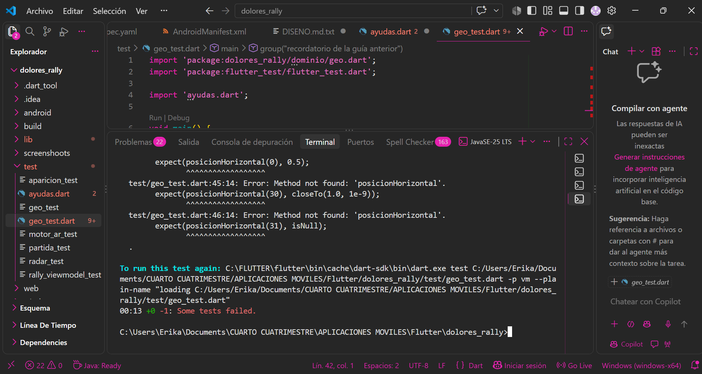</td>
    <td>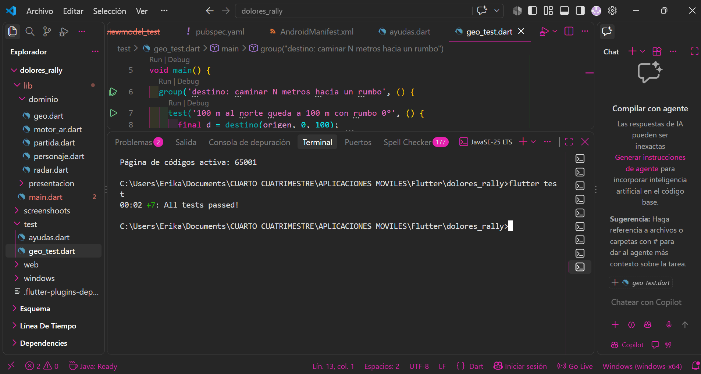</td>
  </tr>
</table>

---

## Ronda 3 

  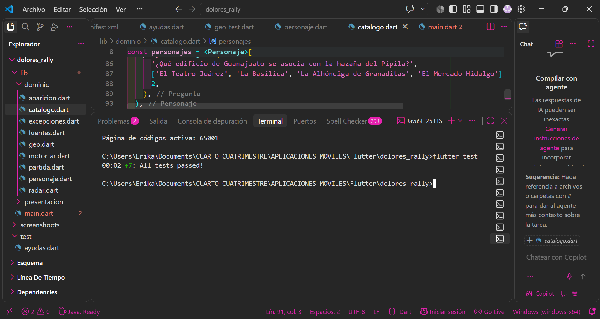

---

## Ronda 4 

*Azar que se puede probar.*

<table>
  <tr>
    <th align="center">ROJO</th>
    <th align="center">VERDE</th>
  </tr>
  <tr>
    <td>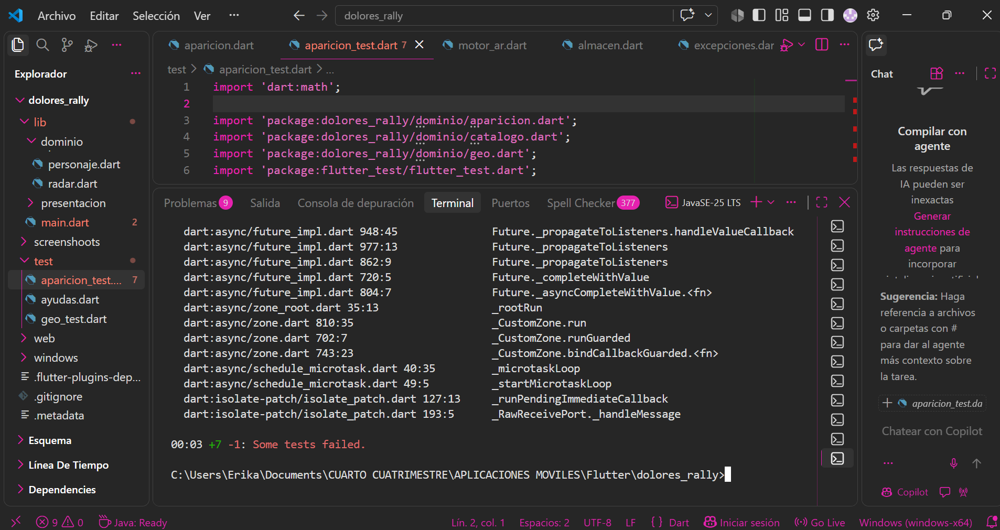</td>
    <td></td>
  </tr>
</table>

---

##  Ronda 5 

<table>
  <tr>
    <th align="center">ROJO</th>
    <th align="center">VERDE</th>
  </tr>
  <tr>
    <td>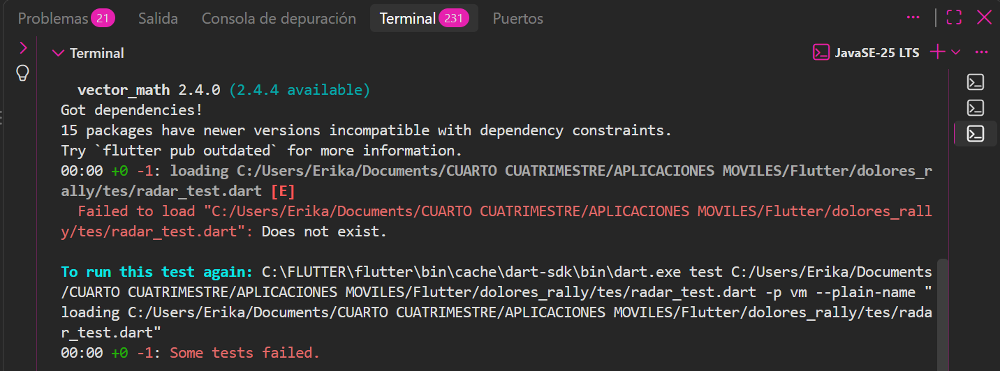</td>
    <td>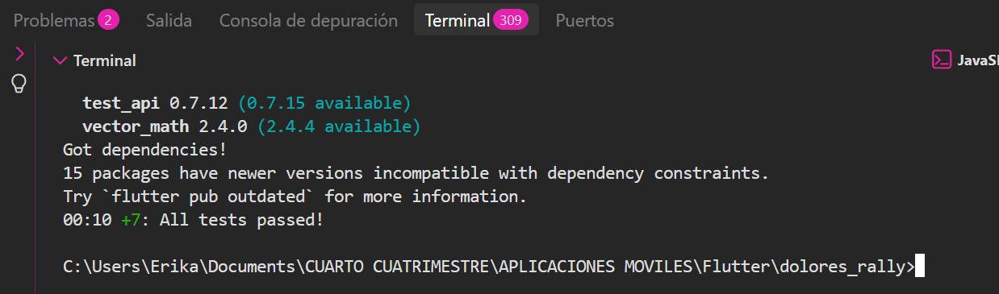</td>
  </tr>
</table>

---

## Ronda 6

<table>
  <tr>
    <th align="center">ROJO</th>
    <th align="center">VERDE</th>
  </tr>
  <tr>
    <td>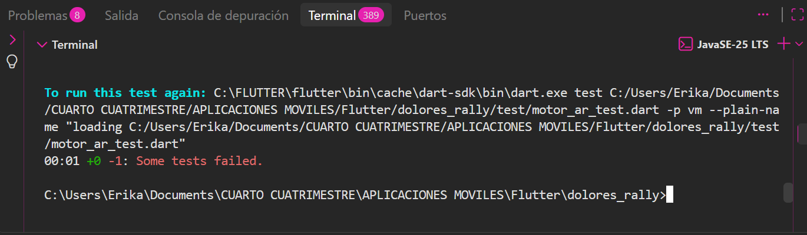</td>
    <td>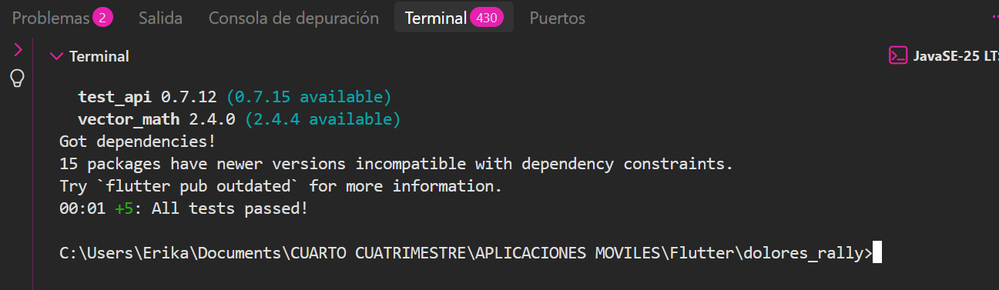</td>
  </tr>
</table>

---

## Ronda 7

<table>
  <tr>
    <th align="center">ROJO</th>
    <th align="center">VERDE</th>
  </tr>
  <tr>
    <td>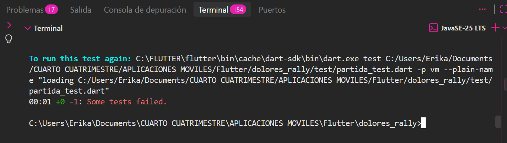</td>
    <td>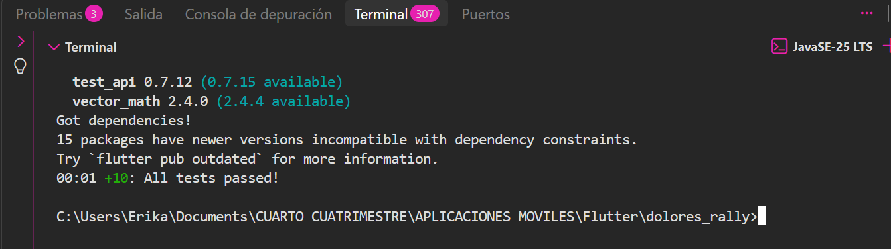</td>
  </tr>
</table>

---

## Ronda 8 

  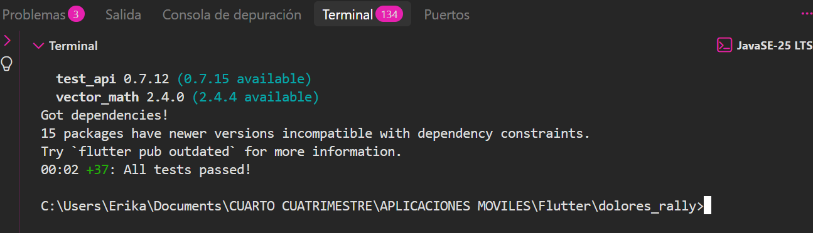

---

## Ronda 9

*Reales y simuladas.*

  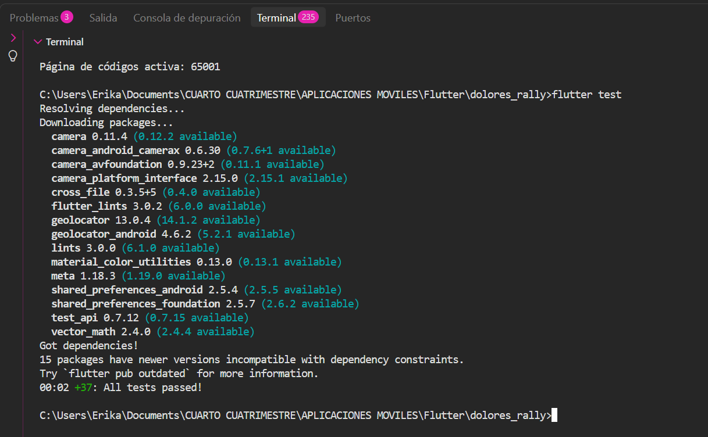

---

## Ronda 10

<table>
  <tr>
    <th align="center">ROJO</th>
    <th align="center">VERDE</th>
  </tr>
  <tr>
    <td>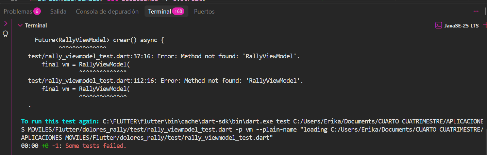</td>
    <td>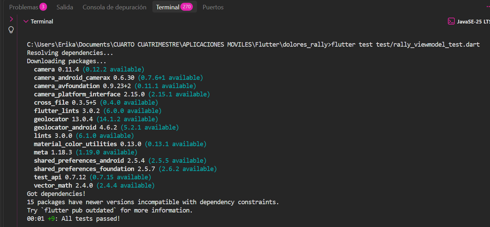</td>
  </tr>
</table>

---

## Ronda 11

<b>Paso 11.1 · El fondo de cámara</b>

 

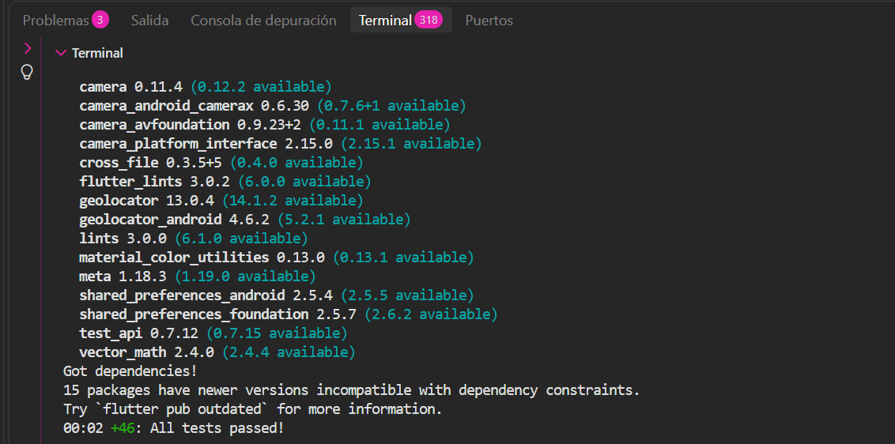

<b>Paso 11.2 · El radar con CustomPainter</b>

 

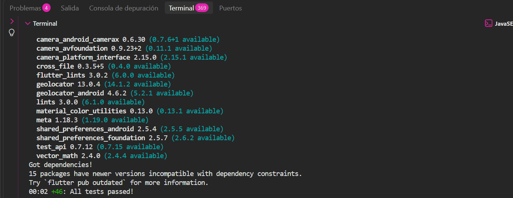

<b>Paso 11.3 · La pantalla del juego</b>

 

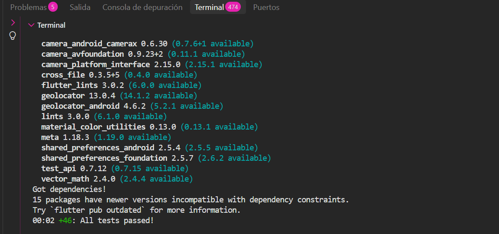

<b>Paso 11.4 · Álbum, inicio y main</b>

 

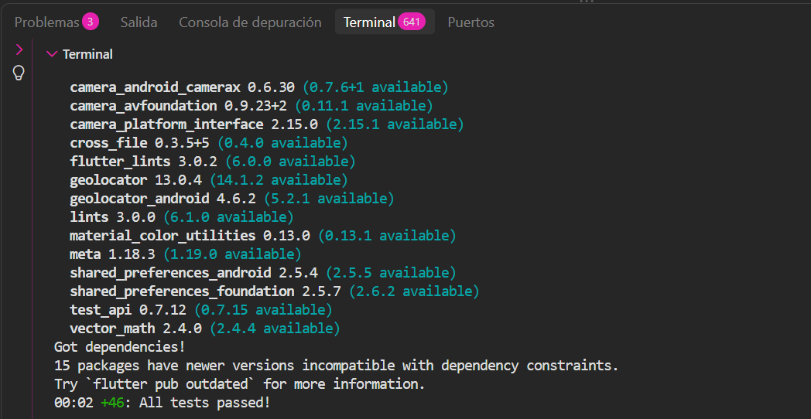

---

##  Paso 11.5

<table align="center">
  <tr>
    <td align="center">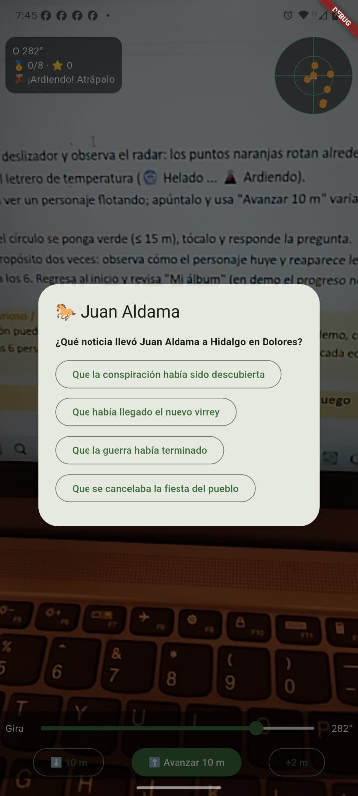</td>
    <td align="center">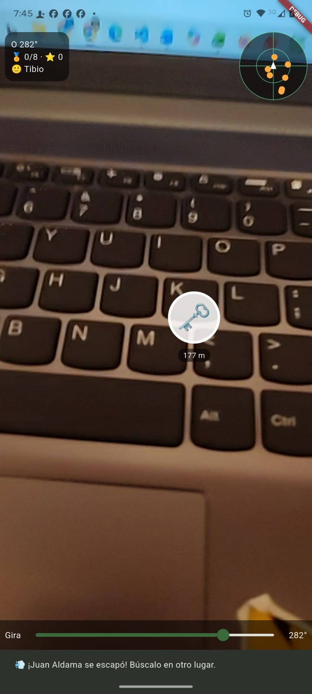</td>
    <td align="center">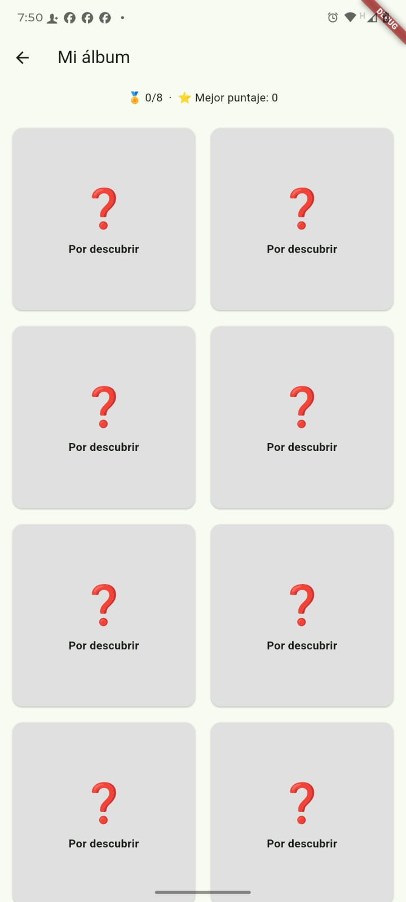</td>
    <td align="center">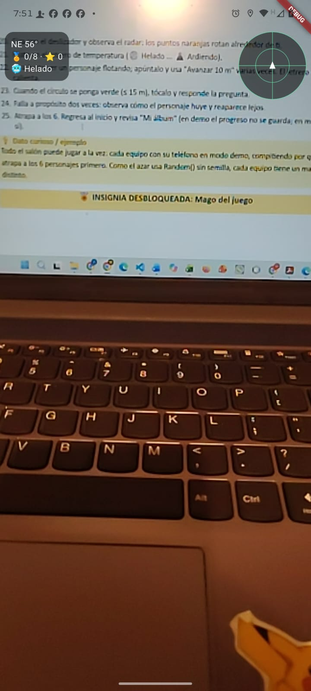</td>
  </tr>
  <tr>
    <td align="center">Escape</td>
    <td align="center">Escape 2</td>
    <td align="center">Mi álbum</td>
    <td align="center">Realidad</td>
  </tr>
</table>

---

